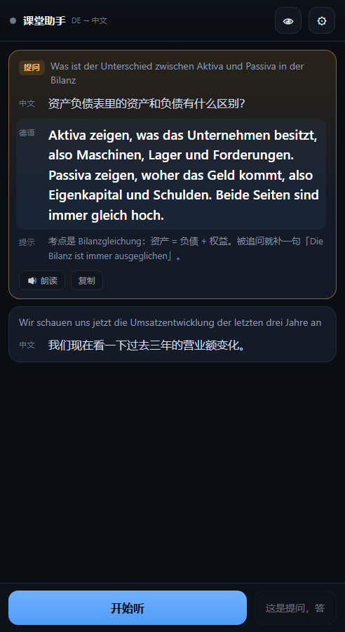

# 课堂助手 · Klassenhelfer

德语课堂用：老师说话的**实时中文字幕**，加上老师一提问就给你的**德语回答稿**（照着念就行）。

- 纯前端，没有后端服务器，API 从手机浏览器直连 DeepSeek
- API Key 只存在手机浏览器的 localStorage 里
- 手机和电脑不需要在同一个网络



---

## 一、装到手机上

### 路线 A：直接传文件（最快，0 配置）

1. 把 `dist/klassenhelfer.html` 发到手机上（微信「文件传输助手」、QQ、数据线都行）
2. 在手机上**用 Chrome 打开**这个文件（在文件管理器里点它时选 Chrome，或微信里选「用其他应用打开 → Chrome」）
3. 点 `⚙` 填 API Key → 「测试连接」看到 `通了` 就可以用

> Chrome 把本地文件也当作安全环境，麦克风和语音识别都能用。
> 缺点：以后更新要重新传一次文件。

### 路线 B：挂到网址上（推荐长期用）

需要你有一个 GitHub 或 Cloudflare 账号（都免费）。挂好之后手机浏览器输入网址即可，还能「添加到主屏幕」变成 App 图标。

**GitHub Pages（推荐，5 分钟）：**

1. 登录 GitHub → 右上角 `+` → **New repository**
   - Repository name 填 `klassenhelfer`（这个名字会出现在网址里）
   - 必须选 **Public**（免费版私有仓库不能开 Pages）
   - 勾 `Add a README file` → **Create repository**
2. 进入仓库 → **Add file** → **Upload files** → 把 `klassenhelfer-site.zip` **解压后**的 9 个文件全选拖进去 → **Commit changes**
   - 必须都在**仓库根目录**，`index.html` 不能落在子文件夹里
3. **Settings** → 左侧 **Pages** → Source 选 **Deploy from a branch**
   - Branch: `main`，Folder: `/ (root)` → **Save**
4. 等 30 秒~2 分钟刷新这个页面，顶部会出现
   `Your site is live at https://<你的用户名>.github.io/klassenhelfer/`

手机 Chrome 打开这个地址 → 允许麦克风 → `⚙` 填一次 Key → 右上角菜单「添加到主屏幕」。

**几个容易踩的点：**

- 仓库公开**没关系**：代码里没有任何 Key，Key 只存在你手机的 localStorage 里
- 网址最后**要有斜杠**，`/klassenhelfer/` 不是 `/klassenhelfer`
- 以后更新文件：重新上传覆盖即可，但记得把 `sw.js` 里的 `klassenhelfer-v1` 改成 `-v2`，否则手机会一直用缓存里的旧版
- 想确认是不是新版本：设置页最下面加一行文字，或直接清 Chrome 的站点数据

### 路线 C：电脑开着当服务器（临时用）

双击 **`start.ps1`**，它会自动起本地服务 + Cloudflare 隧道，并把网址打印出来。

缺点：电脑必须一直开机联网；每次重启**网址会变**，而 API Key 是按域名保存的，所以**每次换网址都要重填一次 Key**。

手动版：

```powershell
python -m http.server 8321
# 另开一个窗口
& "C:\Program Files (x86)\cloudflared\cloudflared.exe" tunnel --url http://127.0.0.1:8321
```

---

## 二、设置怎么填

打开 `⚙`，只有两项真的影响效果：

| 项 | 怎么填 | 为什么重要 |
|---|---|---|
| **课程背景** | 年级 + 课程名 + 本周主题 + 老师习惯。例：`本科三年级，Betriebswirtschaftslehre II，本周讲 Marketing-Mix（4P）。老师爱举德国中型企业的例子。` | 决定翻译准确率和答案是否像人话，**这一项收益最大** |
| **我的名字** | 老师点你名时用的叫法，如 `Yu` | 老师喊你会特别标注、优先作答 |

其余：

- **接口地址**：`https://api.deepseek.com`（换别的 OpenAI 兼容服务就改这里，比如 `https://api.openai.com/v1`）
- **模型**：`deepseek-chat` 又快又便宜，够用；`deepseek-reasoner` 更聪明但慢一倍
- **老师说的语言**：德语课就选德语，选错了一个字都认不出来
- **自动答题**：关掉就只翻译不震动，看到提问再点「这是提问，答」
- **自动朗读**：戴一只耳机时打开，答案会直接念德语给你听

---

## 三、上课怎么用

1. 进教室前先点「测试连接」，确认网络和 Key 都通
2. 手机**屏幕朝上放在桌上，尽量靠前**（离老师越近，识别越准）
3. 点「开始听」，屏幕会保持常亮（用了 Wake Lock）
4. 老师说话 → 中文实时上屏；他在提问 → 卡片变黄、手机震一下，德语回答就在那里
5. 没听清或漏了，点「这是提问，答」让它对刚才那句话重新作答

**关于收音（这是效果上限）**：手机麦克风是远场的，老师站在三米外、教室有回声，识别率会明显下降。想稳一点，花几十块买个领夹麦或蓝牙麦，或者往前坐两排，比任何软件优化都管用。

**关于延迟**：说话结束 → 中文约 1.5 秒 → 德语答案约 2.5~3.5 秒。做不到零延迟。

**成本**：翻译每句都在调模型。一次问答大约几厘钱，90 分钟一节课大概几分到几毛钱，取决于老师说话的密度。

---

## 四、出问题了

| 现象 | 原因 / 解决 |
|---|---|
| 点「开始听」没反应 | 用的是微信/QQ 内置浏览器。复制网址到 Chrome 打开 |
| 一句话都识别不出来 | 设置里的「老师说的语言」选错了；或者手机没给麦克风权限 |
| 卡片一直「翻译中…」然后报错 | Key 不对（401）、余额不足（402）、网络断。看提示条的红字 |
| 识别到的德语错得离谱 | 离老师太远、教室回声大。靠近或加麦克风 |
| 答案很泛、不像在讲这门课 | 课程背景没填或太笼统 |
| 屏幕锁了就停了 | 建议关掉自动锁屏，或用「保持屏幕常亮」；我用了 Wake Lock，但部分机型仍会失效 |
| 想确认是不是 CORS/网络问题 | 用手机 Chrome 打开同目录的 `diagnose.html`，它会直接打一次请求并把结果写在页面上 |

---

## 五、文件说明 & 二次开发

```
index.html            界面骨架
app.js                语音识别、流式请求、卡片渲染
logic.js              纯逻辑：问句识别 / 流式协议解析 / 提示词（无 DOM 依赖）
styles.css            样式（含低调模式）
sw.js                 离线壳缓存
manifest.webmanifest  PWA 安装信息
build_single.py       打包成单文件 dist/klassenhelfer.html
make_icons.py         生成图标
test/logic.test.js    单元测试
```

跑测试（不需要装任何东西）：

```powershell
node test/logic.test.js
```

连真接口跑一遍（会消耗少量额度，检查提示词和解析是否还正常）：

```powershell
$env:KH_KEY="sk-..."      # 你的 Key，只在当前窗口有效
node test/live_check.js
```

本地预览（界面长什么样）：

```
http://127.0.0.1:8321/index.html?demo
```

调试参数：`?metrics` 会在页面底部打印视口尺寸和横向溢出元素；诊断页支持 `?base=...` 覆盖接口地址（换别的服务商时方便）。

**协议**：模型按 `@@Q / @@T / @@A / @@H` 四段流式输出（问题判定 / 中文翻译 / 德语回答 / 中文提示），
`logic.js` 里的 `createParser()` 增量解析，所以翻译能先于回答上屏。

**想改性格**：改 `logic.js` 里的 `SYSTEM_PROMPT`。想让它回答更长/更短、更学术/更口语，都只动这一处。
